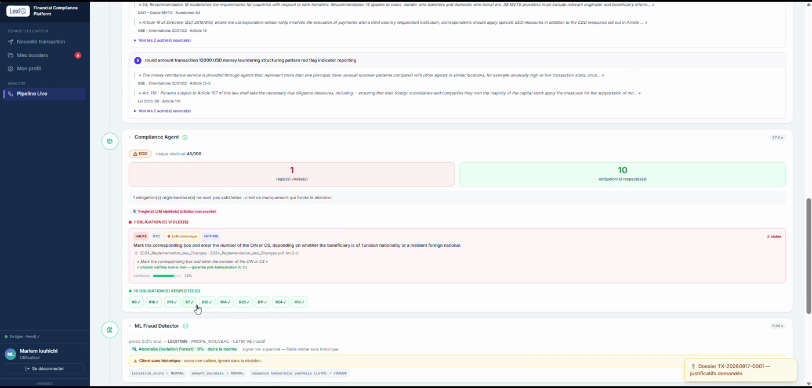
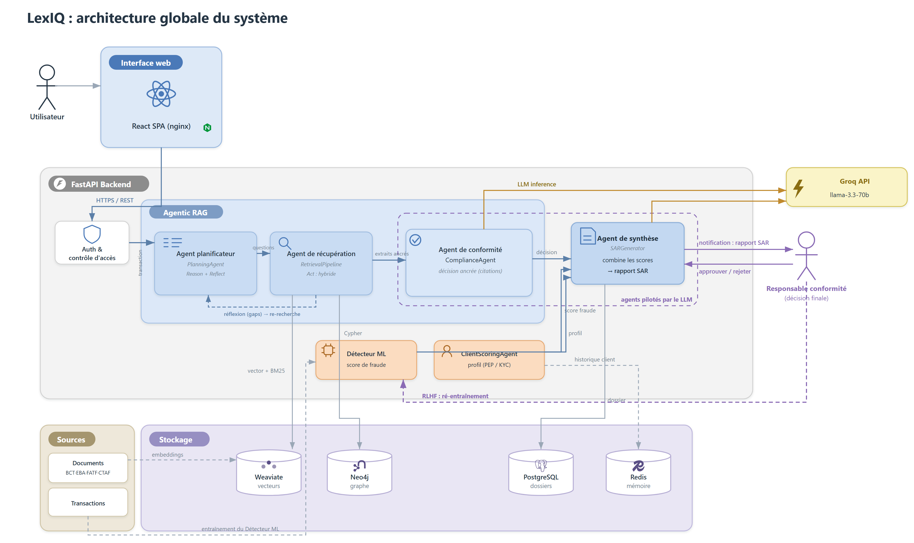
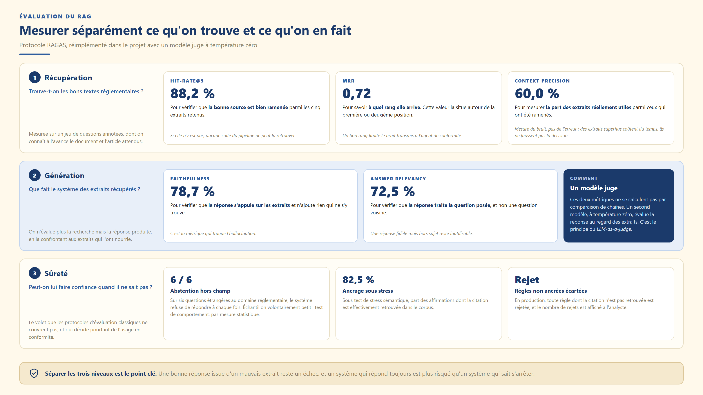

# LexIQ — Surveillance multi-agent des opérations financières

**Plateforme d'analyse de conformité AML/KYC qui justifie chacune de ses décisions par le texte de loi qui la fonde.**

Système neuro-symbolique appliqué à la réglementation bancaire tunisienne (BCT, CTAF) et aux standards internationaux (GAFI, Bâle, UE).



---

## Le problème

Pour chaque opération, une banque doit décider : conforme, vigilance renforcée, ou déclaration de soupçon. Cette décision doit être **justifiée juridiquement**, pas seulement statistiquement, et **traçable** devant un contrôle.

Un modèle de détection seul ne peut pas y répondre : il ne cite aucun article de loi. Un moteur de règles seul ne voit pas les comportements inhabituels. Cette plateforme combine les deux, sous une règle stricte : **le déterministe prévaut toujours**.

---

## Ce qui distingue cette approche

**Aucune règle sans preuve.** Chaque obligation retenue est reliée à son texte source par une chaîne d'ancrage, avec citation vérifiée **mot à mot dans le corpus**. Une règle dont la citation n'est pas retrouvée est rejetée, et le rejet est affiché à l'analyste.

**Le système sait se taire.** Quand les sources sont insuffisantes ou la question hors du champ réglementaire, il s'abstient au lieu de produire une réponse plausible. En conformité, une abstention vaut mieux qu'une affirmation non fondée.

**Le modèle ne peut que renforcer.** Un score statistique n'est pas une source de droit : il peut aggraver une décision, jamais innocenter une opération que les règles ont signalée.

**L'humain tranche.** Toute décision qui n'est pas une validation automatique part dans la file du responsable conformité. Son verdict alimente ensuite le réentraînement du modèle.

---

## Architecture



Chaque transaction traverse un pipeline en neuf étapes :

```
[0] Justificatifs    analyse documentaire — le document prouve-t-il l'opération ?
[1] Niveau 1         règles déterministes : sanctions, pays à risque, seuils BCT
[2] Scoring client   risque structurel du client, facteur par facteur
[3] Planification    génération des questions réglementaires à poser
[4] Récupération     recherche hybride : vectoriel + BM25 + graphe, puis reclassement
[5] Conformité       cœur neuro-symbolique : obligations applicables et violées
[6] Détection ML     analyse comportementale et explicabilité
[7] Rapport SAR      déclaration de soupçon structurée et traçable
[8] Workflow         machine à états et file de validation humaine
```

Trois espaces cloisonnés par rôle — **utilisateur**, **conformité**, **administration** — avec un contrôle d'accès appliqué **côté serveur**, jamais seulement masqué dans l'interface.

---

## Résultats mesurés

**Détection de fraude** — 120 001 transactions de test, dont 1 036 fraudes

| PR-AUC | F1 | Précision | Rappel |
|:---:|:---:|:---:|:---:|
| 0,952 | 0,956 | 0,972 | 0,941 |

975 fraudes détectées sur 1 036, pour 28 fausses alertes sur 118 965 opérations normales.
*L'accuracy atteint 99,93 %, mais prédire « normal » partout en donnerait déjà 99,14 % : sur un jeu à 0,86 % de fraudes, elle ne mesure rien.*

**Recherche réglementaire** — jeu de questions annotées

| Hit-Rate@5 | MRR | Fidélité | Pertinence | Précision du contexte |
|:---:|:---:|:---:|:---:|:---:|
| 88,2 % | 0,72 | 78,7 % | 72,5 % | 60,0 % |

*Les trois dernières suivent le protocole RAGAS, réimplémenté avec un modèle juge à température zéro.*

**Couverture réglementaire** — 94,7 % des recommandations du GAFI applicables, 84,1 % des textes contraignants de la banque centrale.



---

## Technologies

| | |
|---|---|
| **Frontend** | React · TypeScript · Vite · Tailwind CSS |
| **Backend** | FastAPI · Uvicorn · Pydantic · Python 3.13 |
| **IA** | Groq · sentence-transformers · docling |
| **Machine learning** | LightGBM · scikit-learn · PyTorch · SHAP |
| **Données** | PostgreSQL · Weaviate · Neo4j · Redis |
| **Déploiement** | Docker · Docker Compose · GitHub Actions · Azure Container Apps |

---

## Démarrage rapide

```bash
cp groq_keys.example.json groq_keys.json      # renseigner une clé Groq
cp smtp_config.example.json smtp_config.json  # optionnel (notifications)

docker compose up -d --build
```

Interface sur `http://localhost:8090`, API sur `http://localhost:8001`.

---

## Où regarder dans le code

Le dépôt contient une centaine de modules. Voici les huit fichiers qui portent l'essentiel.

| Fichier | Ce qu'il fait |
|---|---|
| [`level1_rules/`](level1_rules/) | Les règles déterministes : sanctions, seuils, pays à risque, fractionnement |
| [`planning_agent.py`](planning_agent.py) | Génère les questions réglementaires et détecte les manques de couverture |
| [`retrieval_agent.py`](retrieval_agent.py) | Recherche hybride en cinq étapes, du corpus au reclassement |
| [`compliance_agent.py`](compliance_agent.py) | Le cœur neuro-symbolique : double chemin, validation d'ancrage, scoring du risque |
| [`ml_fraud_detector_v4.py`](ml_fraud_detector_v4.py) | Le pipeline d'entraînement : variables, détecteurs non supervisés, modèle supervisé |
| [`sar_generator.py`](sar_generator.py) | Fusion des scores et rédaction de la déclaration de soupçon |
| [`rlhf.py`](rlhf.py) | Réentraînement incrémental à partir des verdicts d'expert, avec garde-fou |
| [`api/main.py`](api/main.py) | L'orchestrateur et les 36 points d'entrée de l'API |

---

## Documentation

- [Architecture technique](docs/architecture-technique.md) — la conception en détail
- [Documentation par composant](docs/composants/) — un document par brique du système
- [Guide de démonstration](docs/guide-demonstration.md) — comment faire tourner un cas complet

---

## Limites assumées

**Le gain de la boucle d'apprentissage n'est pas démontré.** Le mécanisme est implémenté et planifié, mais le volume de verdicts d'expert accumulé est resté sous le seuil de déclenchement : le système a refusé de réentraîner sur un échantillon trop faible, ce qui est le comportement attendu. Le mesurer demande plusieurs semaines d'exploitation réelle.

**Pas d'observabilité en production.** Ni métriques centralisées, ni tests de charge, ni chiffrement au repos, ni haute disponibilité. Ce sont des exigences d'exploitation réelle, hors du périmètre du projet.

**Les données sont synthétiques.** Les transactions proviennent d'un jeu public : les données AML réelles ne sont pas partageables.

---

## Contexte

Projet de fin d'études en génie informatique, réalisé chez **VERMEG** de février à août 2026, en huit sprints selon une démarche Scrum.
